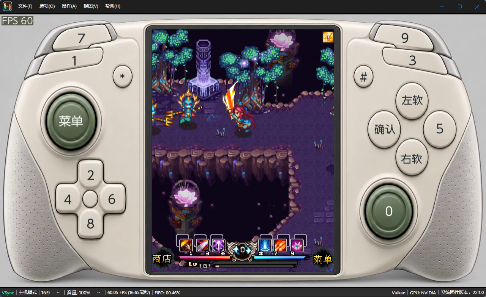
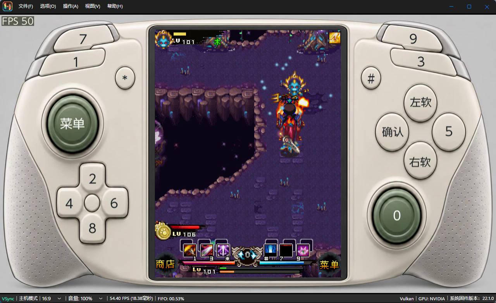
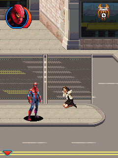
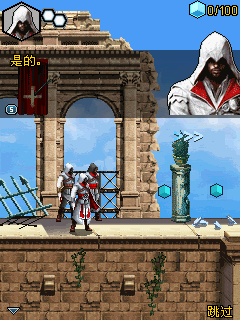
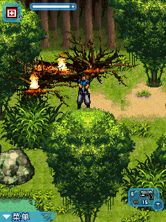

# Pi Java emulator


**A J2ME / MIDP emulator for Nintendo Switch homebrew environments.**

[Download Fit30](https://github.com/incuryou/PiJava/releases/tag/v0.2.114-keyui7-gpuf5-fit30) · [中文](README.md) · [Build](docs/BUILDING.md) · [Usage](docs/USAGE.md) · [Third-party licenses](THIRD_PARTY.md)

Current release: **Fit30 / KeyUI7 / GPUF5**, build `0.2.114-keyui7-gpuf5-fit30`, NACP `0.2.114-k7-f30`. The application Title ID remains `05004A324D450000`.

## Fit30

- Bounded fusion of two generic read-only getter shapes reduces interpreter preparation while preserving operation budgets and exception fallback.
- Slow-paint reports now associate CPU time and observed waits with the same selected paint. Game-requested waits and clock policy are unchanged.
- Earlier Graphics query shortcuts, standard stream field-slot caching, and full-ellipse rendering improvements remain included.
- The controlled original sprite replay used about 1.6% less calling-thread CPU at the median. This is not a physical Switch or whole-game FPS claim.

See [the Fit30 validation report](docs/FIT30.md). Host validation and package-content checks passed; they do not establish full-game compatibility or guaranteed 60 FPS.

## Screenshots

The two masked views below are extracted from a user-provided video at 76.131 and 214.554 seconds. Its build version is unverified; these are interface examples, not Fit30 device-performance evidence.




These game-only images are Fit30 host VM replays, not physical Switch captures:

| Spider-Man | Assassin's Creed Brotherhood | Biohazard Thriller 2 |
|---|---|---|
|  |  |  |

## Features and scope

- Load authorized JARs from `SD:/switch/j2me/games/`.
- MIDlet lifecycle, Canvas/GameCanvas, 2D graphics and text, with selected vendor and 3D APIs.
- Per-game controls, phone/controller masks, RMS, J2S5 snapshots and explicit cross-chapter RMS copying.
- MIDI/WAV and FFmpeg-based compressed audio decoding.
- Native/30/60 speed targets and five GPU display filters through deko3d; original display uses the CPU presenter.

The Java VM remains cooperatively scheduled. Host workers handle audio, GC tracing and selected pixel preparation; this does not mean multiple Java interpreters run the game in parallel or that all 3D rendering is hardware accelerated.

## Build and downloads

```sh
python3 -B tools/build.py --frozen-java
DEVKITPRO=/opt/devkitpro python3 -B tools/build.py --switch --frozen-java
```

The standalone NSP does not require an external NRO. Release attachments include the matching source, NRO, debug ELF archive, validation report and checksums. Production files and documentation are maintained in this repository; the complete source archive also contains regression fixtures. Commercial games, saves, private keys, original user logs and SDK installations are not distributed.

Project code is GPL-3.0-or-later. Preserve third-party notices and licenses in [LICENSE](LICENSE), [NOTICE.md](NOTICE.md), [THIRD_PARTY.md](THIRD_PARTY.md) and [dependency sources](docs/DEPENDENCY-SOURCES.md). Contributions: [CONTRIBUTING.md](CONTRIBUTING.md). This project is not affiliated with Nintendo or Nokia.
