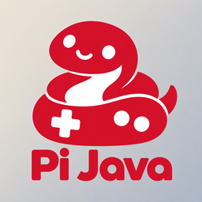

# Pi Java模拟器



**面向 Nintendo Switch 自制软件环境的 J2ME / MIDP 模拟器。**

[下载 NRO / NSP](https://github.com/incuryou/PiJava/releases/latest) · [English](README.en.md) · [构建](docs/BUILDING.md) · [使用](docs/USAGE.md) · [架构与路线](docs/ROADMAP.md) · [许可](THIRD_PARTY.md)

当前发布：**KeyUI6 / GPUF5 / Save1**。程序内部构建标识沿用 `0.2.114-keyui5-gpuf5-save1`，NACP 短版本为 `0.2.114-k5-sv1`；KeyUI6 表示映射界面的后续布局修订。仓库地址保留 `incuryou/PiJava`，项目展示名称为 **Pi Java模拟器**。

项目以 C++17 实现 VM 和宿主功能，附带 Java 类库与所需字体、皮肤及着色器资源。Switch 是主要平台，Linux 桌面入口用于无窗口开发诊断。兼容性仍需逐游戏验证，能启动不等于全部关卡、音频与存档都通过。

## 本次新增与调整

- **KeyUI6 映射界面**：删除手机参考图片及其加载/高亮代码，将手机键网格、Pro 手柄预览和映射槽居中排列；保留实时映射预览、长按循环、未绑定留空和现有按键操作。
- **GPUF5 五种 GPU 滤镜**：双线性、Scale2x、LCD、CRT、ScanlinesDX 自动选择 GPU；关闭滤镜时使用 CPU 呈现。包含显示槽、fence、缓存失效与可恢复的 CPU 后备路径。
- **Save1 跨章节存档继承**：在游戏列表选中下一章，按 Y 选择上一章，将游戏内 RMS 存档显式复制到目标，并备份目标旧目录；不修改来源，不自动转换游戏私有存档格式，不跨 JAR 继承即时存档。
- **统一应用图标**：NRO 与 NSP 均使用新的 Pi Java 图标。

## 三 CPU 核心与 GPU 分工

当前 Switch 后端采用**三个 CPU 核心参与的宿主分工，并调用 GPU 执行显示滤镜与呈现**。已发布 NSP 的主线程默认运行于 CPU 0；两个工作线程分别绑定 CPU 1、CPU 2，承担音频、GC 跟踪和部分 CPU 像素准备等任务，异步日志线程复用 CPU 2。NRO 的主线程亲和性还取决于 hbloader 启动环境。

这里的三核分工不等于三个 Java 执行器并行运行游戏，也不表示三个核心始终满载。GPU 路径通过 deko3d 执行上述五种显示滤镜；原画、菜单及部分合成仍有 CPU 工作。当前不能把 GPU 滤镜等同于完整的 3D 游戏硬件加速。

## 主要功能

- 从 `SD:/switch/j2me/games/` 载入你有权使用的 JAR。
- MIDlet 生命周期、Canvas / GameCanvas、2D 图像与文字绘制；部分厂商扩展和 3D API 实现。
- 每游戏按键映射、三款 Pro 手柄遮罩、既有手机风格遮罩及无边框显示。
- 游戏内 RMS、J2S5 即时存档，以及跨章节 RMS 继承。
- MIDI / WAV 与基于 FFmpeg 的压缩音频解码。
- Native / 30 / 60 速度目标、采样 FPS 和显示滤镜；选择 60 不保证所有游戏产生 60 次独立逻辑更新。

## 下载与使用

请在 [Releases](https://github.com/incuryou/PiJava/releases/latest) 下载最新 `.nro` 或 `.nsp`，按自己的自制软件运行环境使用。二者是本次提交的现成构建，未在公开整理时重编译；NSP 为独立应用包。游戏、用户 RMS、即时存档、密钥及 SDK 均不随仓库或 Release 分发。

本版交付报告记录了构建、针对性检查及 20 款游戏的短时抽样；这不代表全部游戏、完整关卡或设备性能验收。公开发布时核对了输入哈希、NRO 内嵌资源与源码一致性，以及 NSP 容器和内容 ID；没有新增实体 Switch 安装启动验收。更多使用和备份事项见[使用说明](docs/USAGE.md)。

## 从源码构建

准备 GCC / JDK 或 devkitPro Switch 工具链后，在仓库根目录运行：

```sh
# Linux 无窗口程序；保留所附 API 字节码
python3 -B tools/build.py --frozen-java

# Switch NRO
DEVKITPRO=/opt/devkitpro python3 -B tools/build.py --switch --frozen-java
```

需要重编 Java 类库时可去掉 `--frozen-java`。着色器从 `shaders/` 离线编译；构建所需完整依赖见[构建文档](docs/BUILDING.md)。

公开树仅包含生产源码、构建工具、必需资源、许可证和说明；测试类、测试报告、运行日志、测试截图、样例游戏与私有 CI 未上传。`romfs/classes/` 是运行时 Java 类库，不是游戏测试类。

## 后续计划

1. 完善 M3G、Mascot Capsule 等 3D 支持，逐步补齐 API、渲染正确性与真实游戏兼容性，并评估专门的 GPU 3D 后端。
2. 优化核心之间的线程与任务协调、同步等待和负载分配，减少主线程、音频、GC、像素准备及 GPU 提交之间的争用。
3. 改善负载峰值、帧时间稳定性、缓存与内存使用，以真实设备、同场景对比验证收益。
4. 持续改善音频、存档恢复与异常处理，提升游戏兼容性。

这些是后续开发方向，不是当前版本已全部完成的功能。详见[架构与路线](docs/ROADMAP.md)。

## 许可证与贡献

项目自有代码采用 **GPL-3.0-or-later**；第三方代码、字体及素材保留各自原许可与来源说明，见 [LICENSE](LICENSE)、[NOTICE.md](NOTICE.md) 和 [THIRD_PARTY.md](THIRD_PARTY.md)。发布所用编解码库的源码、补丁和构建配方入口见 [docs/DEPENDENCY-SOURCES.md](docs/DEPENDENCY-SOURCES.md)。

欢迎提交可复现的问题与补丁，参见 [CONTRIBUTING.md](CONTRIBUTING.md)。本项目与 Nintendo、Nokia 等厂商无隶属或背书关系。
