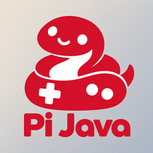
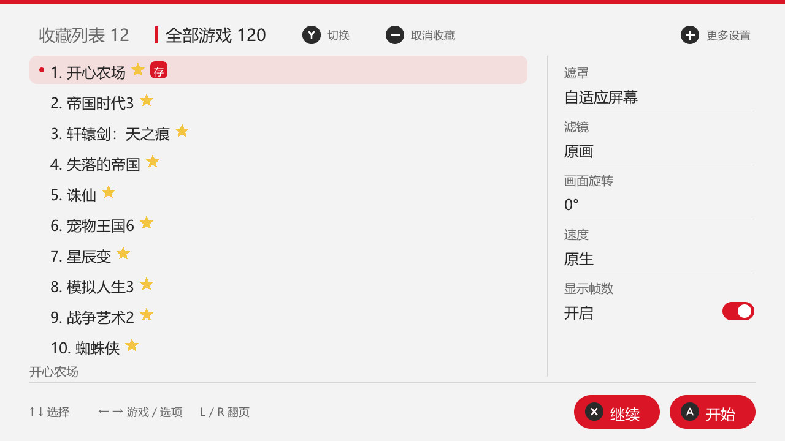
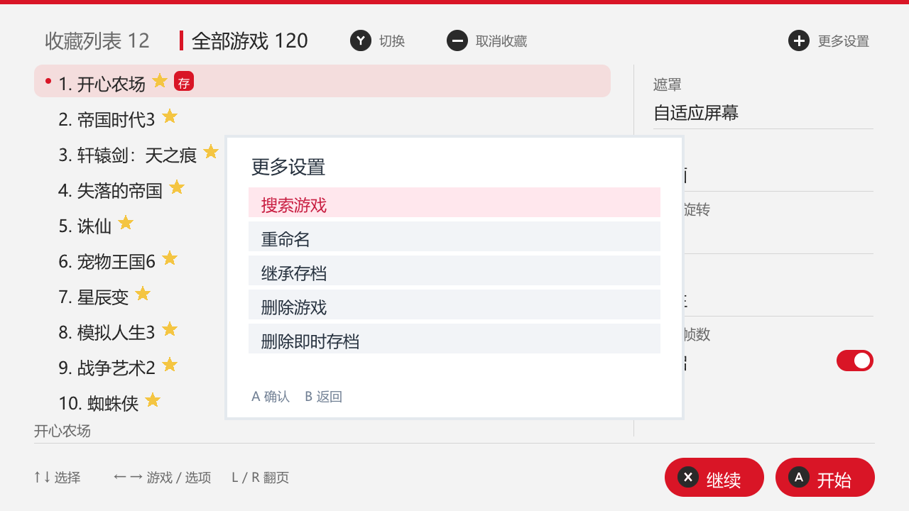
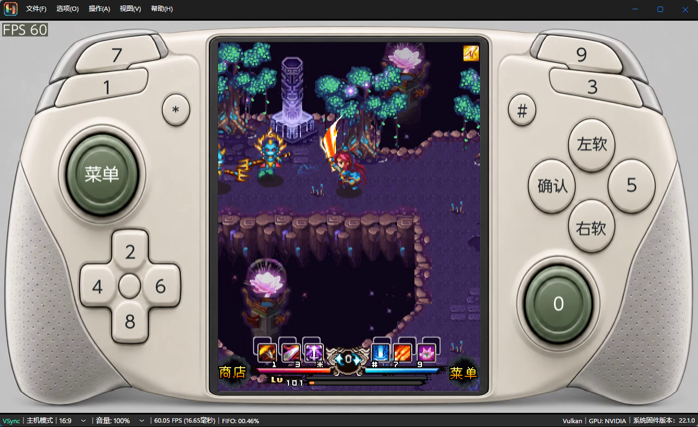
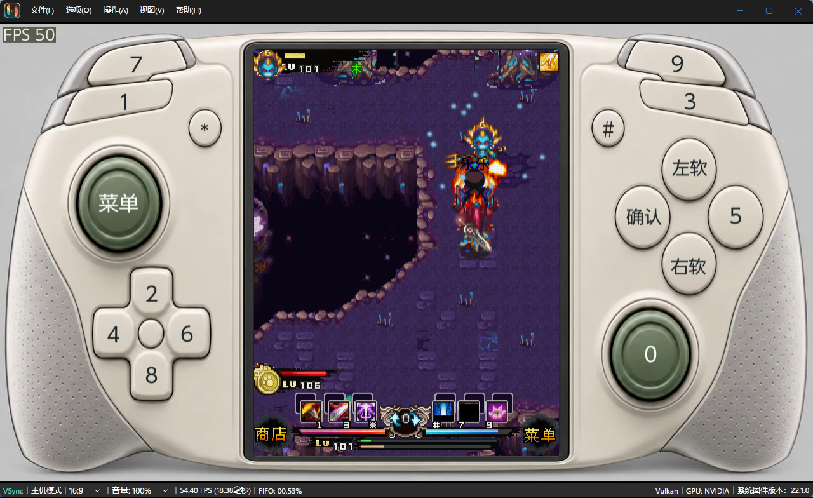
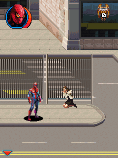
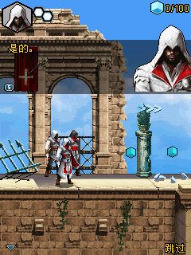
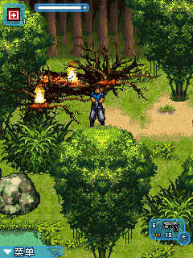

# Pi Java模拟器



**面向 Nintendo Switch 自制软件环境的 J2ME / MIDP 模拟器。**

[下载 NRO / NSP](https://github.com/incuryou/PiJava/releases/latest) · [English](README.en.md) · [构建](docs/BUILDING.md) · [使用](docs/USAGE.md) · [架构与路线](docs/ROADMAP.md) · [许可](THIRD_PARTY.md)

当前发布：**Fit41-menu7 / KeyUI7 / GPUF5**。构建标识 `0.2.114-keyui7-gpuf5-fit41-menu7`，NACP `0.2.114-k7-f41n`。应用 Title ID 沿用 `05004A324D450000`。

[下载 Fit41-menu7](https://github.com/incuryou/PiJava/releases/tag/v0.2.114-keyui7-gpuf5-fit41-menu7) · [新增功能与验证](docs/FIT41.md)

项目以 C++17 实现 VM 和宿主功能，附带 Java 类库与所需字体、皮肤及着色器资源。Switch 是主要平台，Linux 桌面入口用于无窗口开发诊断。兼容性仍需逐游戏验证，能启动不等于全部关卡、音频与存档都通过。

## Fit41-menu7 更新

- 10 项游戏列表、收藏 / 全部列表、Y 切换与 − 收藏操作。
- 更多设置支持搜索、中文重命名、存档继承与删除操作，长按上下循环。
- 游戏内 L3 菜单增加整数搜索、多轮筛选与候选值修改。
- 改进 Micro3D / M3G 兼容性，完善原生图片预处理、画面呈现分工与等待空转处理。
- 保留现有存档与配置兼容路径。详细功能、默认配置和测试范围见[更新说明](docs/FIT41.md)。

| 主菜单 | 更多设置 |
|---|---|
|  |  |

以上为原生宿主 UI 预览，不是 Switch 实机截图。以下 Fit30 内容与运行画面保留作历史记录。

## Fit30 更新（历史）

- 保留此前绘图查询直达、标准流字段缓存和完整椭圆绘制改进。
- 为两种通用只读取值方法省去重复解释准备，保持原操作预算和异常回退。
- 补齐同一次慢 paint 的 CPU／等待诊断，不修改游戏主动等待、时钟倍率或存档格式。
- 受控原版精灵回放 CPU 改善中位数约1.6%；不是实体 Switch 整局帧率结论，也不保证所有游戏60帧。

## 运行画面

以下两张带遮罩画面截自用户提供的视频（00:01:16.131、00:03:34.554）。视频版本未核定，属于界面展示，不作为 Fit30 或实体 Switch 性能证据。




下面是 Fit30 的主机 VM 正常按键回放，仅显示游戏画面，不是实体 Switch 截图。

| 蜘蛛侠 | 刺客信条兄弟会 | 生化惊悚2 |
|---|---|---|
|  |  |  |

## 保留的功能

- **按键映射界面**：删除手机参考图片及其加载/高亮代码，将手机键网格、Pro 手柄预览和映射槽居中排列；保留实时映射预览、长按循环、未绑定留空和现有按键操作。
- **GPUF5 五种 GPU 滤镜**：双线性、Scale2x、LCD、CRT、ScanlinesDX 自动选择 GPU；原图、滤镜与呈现保留可恢复的 CPU 后备路径。
- **Save1 跨章节存档继承**：在游戏列表选中下一章，通过“更多设置 → 继承存档”选择上一章，将游戏内 RMS 存档显式复制到目标，并备份目标旧目录；不修改来源，不自动转换游戏私有存档格式，不跨 JAR 继承即时存档。
- **统一应用图标**：NRO 与 NSP 均使用新的 Pi Java 图标。

## CPU 与 GPU 分工

Java 执行及可变游戏状态仍由其所属线程管理；原生图片预处理、音频、GC 跟踪和画面呈现按各自任务分工。图片预处理与 render-owner 默认开启，具体收益取决于游戏负载与同步开销，并不表示所有核心始终满载。

GPU 显示滤镜和呈现使用 deko3d。M3G CPU worker 与实验性 GPU 3D 需显式开启；这不等于所有 3D 游戏已获得硬件加速。

## 主要功能

- 从 `SD:/switch/j2me/games/` 载入你有权使用的 JAR。
- MIDlet 生命周期、Canvas / GameCanvas、2D 图像与文字绘制；部分厂商扩展和 3D API 实现。
- 每游戏按键映射、三款 Pro 手柄遮罩、既有手机风格遮罩及无边框显示。
- 游戏内 RMS、J2S5 即时存档，以及跨章节 RMS 继承。
- MIDI / WAV 与基于 FFmpeg 的压缩音频解码。
- Native / 30 / 60 速度目标、采样 FPS 和显示滤镜；选择 60 不保证所有游戏产生 60 次独立逻辑更新。

## 下载与使用

请在 [Releases](https://github.com/incuryou/PiJava/releases/latest) 下载最新 `.nro` 或 `.nsp`，按自己的自制软件运行环境使用。Fit41-menu7使用已校验的同源构建；NSP为独立应用包。游戏、用户 RMS、即时存档、密钥及 SDK 均不随仓库或 Release 分发。

Fit30完成64条组合主机检查、九项原版游戏短场景检查及NSP内容校验。短检查不能代替完整关卡或实体Switch性能验收；详见[Fit30报告](docs/FIT30.md)。

## 从源码构建

准备 GCC / JDK 或 devkitPro Switch 工具链后，在仓库根目录运行：

```sh
# Linux 无窗口程序；保留所附 API 字节码
python3 -B tools/build.py --frozen-java

# Switch NRO
DEVKITPRO=/opt/devkitpro python3 -B tools/build.py --switch --frozen-java
```

需要重编 Java 类库时可去掉 `--frozen-java`。着色器从 `shaders/` 离线编译；构建所需完整依赖见[构建文档](docs/BUILDING.md)。

公开树保留生产源码、构建工具、必需资源、许可证、说明及选定展示截图。完整Fit41-menu7源码包另含回归夹具；原始用户日志、商业游戏、存档、密钥和私有CI不上传。`romfs/classes/` 是运行时 Java 类库，不是游戏测试类。

## 后续计划

1. 完善 M3G、Mascot Capsule 等 3D 支持，逐步补齐 API、渲染正确性与真实游戏兼容性，并评估专门的 GPU 3D 后端。
2. 优化核心之间的线程与任务协调、同步等待和负载分配，减少主线程、音频、GC、像素准备及 GPU 提交之间的争用。
3. 改善负载峰值、帧时间稳定性、缓存与内存使用，以真实设备、同场景对比验证收益。
4. 持续改善音频、存档恢复与异常处理，提升游戏兼容性。

这些是后续开发方向，不是当前版本已全部完成的功能。详见[架构与路线](docs/ROADMAP.md)。

## 许可证与贡献

项目自有代码采用 **GPL-3.0-or-later**；第三方代码、字体及素材保留各自原许可与来源说明，见 [LICENSE](LICENSE)、[NOTICE.md](NOTICE.md) 和 [THIRD_PARTY.md](THIRD_PARTY.md)。发布所用编解码库的源码、补丁和构建配方入口见 [docs/DEPENDENCY-SOURCES.md](docs/DEPENDENCY-SOURCES.md)。

欢迎提交可复现的问题与补丁，参见 [CONTRIBUTING.md](CONTRIBUTING.md)。本项目与 Nintendo、Nokia 等厂商无隶属或背书关系。
